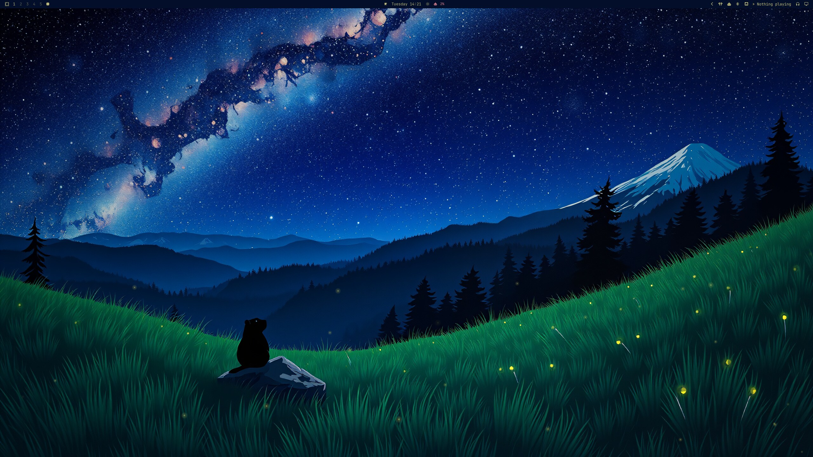

# Starwatch Background

> **Superseded.** This plugin is now [omarchy-living-background](https://github.com/prostratepossum/omarchy-living-background), part of [Omarchy Living Themes](https://github.com/prostratepossum/omarchy-living-themes). It has the same Starwatch scene plus Moonlit Hearth, and switches automatically with your theme. This repository is archived and gets no further updates.

A live wallpaper for Omarchy. Stars in your wallpaper twinkle, fireflies drift and pulse in the grass, and now and then a shooting star crosses the sky.



It is a fork of Omarchy's built-in `omarchy.background`: click handling, background switching and transitions are unchanged, with a GPU shader layer on top. It runs at 30 fps and pauses while a window is fullscreen. On an RX 9070 XT it costs about 8 W and ~2% GPU busy.

Animation turns on only for wallpapers whose filename contains `starwatch`. The [Alpine Marmot theme](https://github.com/prostratepossum/omarchy-alpine-marmot-theme) ships one (`0-starwatch.jpg`), and you can also rename any night-sky wallpaper. The shader finds stars and fireflies in the image itself (bright points in the sky, yellow blobs in grass), so no extra art is needed.

## Install

```bash
omarchy plugin add https://github.com/prostratepossum/omarchy-starwatch-background --enable
```

Enabling it switches off the built-in `omarchy.background` automatically.

## Use

```bash
omarchy-shell -q background toggleAnimation   # pause / resume
omarchy-shell -q background setAnimation false
```

## Remove

```bash
omarchy plugin remove io.github.prostratepossum.starwatch-background
```

This restores the stock background plugin.

## Dependencies

None beyond Omarchy (Quickshell / Qt 6). The shader ships precompiled as `starwatch.frag.qsb`. After editing `starwatch.frag`, rebuild it with:

```bash
/usr/lib/qt6/bin/qsb --glsl "100es,120,150" --hlsl 50 --msl 12 -o starwatch.frag.qsb starwatch.frag
```

## License

Code: MIT, derived from Omarchy's `omarchy.background` (MIT). Preview art is for personal use only. See [LICENSE](LICENSE).
